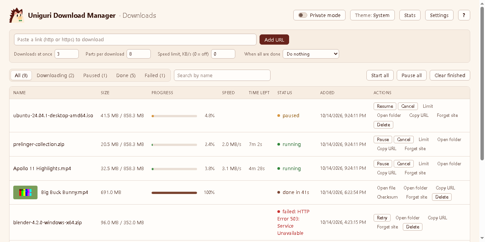
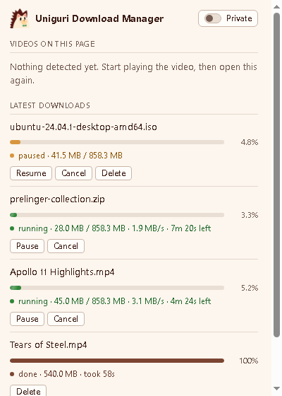
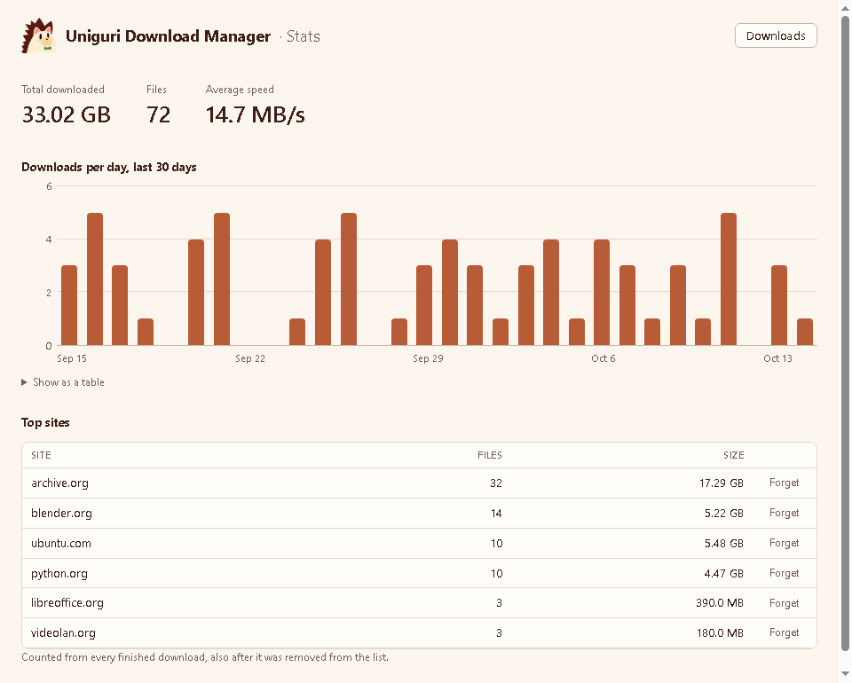
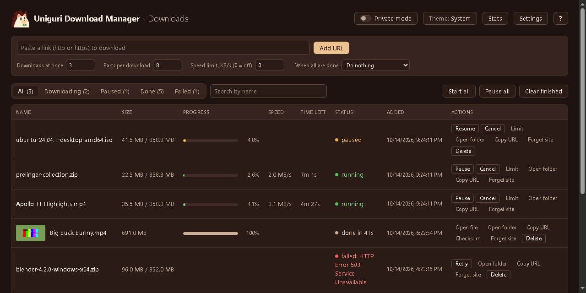

<p align="center"></p>

# UDM (Uniguri Download Manager)

A free download manager for Windows that works with Chrome, Brave and Edge. Downloads you start in
the browser go to UDM instead, which fetches them in parallel parts, so they are often faster, and
lets you pause, resume, queue and limit them. It can also save videos that play as streams.

Everything runs on your own PC: no account, no outside services, no tracking.



| Popup | Stats |
|---|---|
|  |  |

<details>
<summary>Dark mode</summary>


</details>

## Features

- **Takes over browser downloads**, with rules: skip sites, only some file types, a minimum size.
  Right-click a link, or Alt+click it, to send it to UDM.
- **Fast and resumable**: up to 32 parts per file. A paused or cut-off download continues where it
  stopped, also after a restart.
- **Video streams** (`.m3u8`, `.mpd`) are found on the page and saved as `.mp4` with ffmpeg. You can
  pick the quality, save subtitles, or save the audio only as `.mp3`.
- **Queue and limits**: how many downloads at once, a speed limit (overall or per download), a
  bandwidth schedule, start and stop times, and what to do when all are done (sleep, shut down).
- **Download manager page**: search, filters, thumbnails of finished videos, checksums, Refresh link
  for expired links, keyboard shortcuts.
- **Stats**: downloads per day, top sites.
- **Privacy**: private mode, incognito downloads are always private, Clear data by time range,
  Forget this site, auto clean, and a log without full links or cookies.
- **Backup**: export and import your history and settings.
- A tray icon near the clock, light and dark themes, and Windows notifications.

The full list, page by page, is in the [manual](docs/MANUAL.md).

## Install

1. Download **`UDM-Setup.exe`** from the [latest release](https://github.com/nstollen/Uniguri-Download-Manager/releases/latest)
   and run it. No admin rights or Python needed.
   - Windows may say *"Windows protected your PC"*, because the installer is not signed by a
     company. Click **More info**, then **Run anyway**.
2. When setup finishes, it opens the `extension` folder and a page with the last 3 steps:
   1. Open `chrome://extensions` (Brave: `brave://extensions`, Edge: `edge://extensions`).
   2. Turn on **Developer mode**.
   3. Click **Load unpacked** and pick `%LOCALAPPDATA%\UDM\extension`.

That's it: the UDM button is in the toolbar's puzzle-piece menu, and the downloader starts with
Windows (the hedgehog near the clock). Downloads are saved to `Downloads\udm`.

- **Update:** run the new `UDM-Setup.exe`, then press the reload arrow on UDM in
  `chrome://extensions`. Your history and settings are kept.
- **Uninstall:** Windows Settings > Apps > UDM. It asks whether to also delete your downloads and
  your history and settings. Then remove the extension in `chrome://extensions`.
- **Incognito:** in `chrome://extensions` > UDM > Details, turn on **Allow in Incognito**.

The same steps in plain words, for sharing: [INSTALL.txt](INSTALL.txt).

## Limits

- **No YouTube.** YouTube does not serve its videos in a form UDM can read.
- **No DRM-protected video**: Netflix, Disney+, Prime Video, Spotify and other sites that encrypt
  their streams cannot be saved.
- Windows 10 and 11 only, and only Chromium browsers (Chrome, Brave, Edge). Not Firefox.
- UDM is not in the Chrome Web Store, so the extension is loaded with Developer mode, and the
  installer is not code-signed (hence the SmartScreen warning).
- Sites that need a login work while the browser sends its cookies with the download. **Start all**
  from the tray or the scheduler cannot send fresh cookies; use Retry on the manager page then.

## Build it yourself

You need, only to build:

- **Python 3** with PyInstaller: `python -m pip install pyinstaller`
- **Inno Setup 6**: https://jrsoftware.org/isdl.php
- **ffmpeg**: get the *essentials* build from https://www.gyan.dev/ffmpeg/builds/ and copy
  `ffmpeg.exe` (and `ffprobe.exe` if you like) from its `bin` folder into `downloader\`.
  It is not in this repository.

Then:

```
git clone https://github.com/nstollen/Uniguri-Download-Manager.git
cd Uniguri-Download-Manager
build.bat
```

The installer is `dist\UDM-Setup.exe`. `build.bat` first builds `udm-downloader.exe` and
`udm-host.exe` with PyInstaller, then the installer from `installer\udm.iss`. To use a Python
that is not first on PATH: `set PYTHON=C:\path\to\python.exe` before `build.bat`.

### Run from source (for development)

No build and no extra Python packages needed:

1. `chrome://extensions` > Developer mode > **Load unpacked** > the `extension` folder.
   Its ID is always `nlpicpbemdokbpgkigobcbobbgbmbpfa`.
2. `python host\install_host.py nlpicpbemdokbpgkigobcbobbgbmbpfa` (registers the native host).
3. `python downloader\downloader.py`, or `python autostart.py on` to start it with Windows.

More in the [manual](docs/MANUAL.md#install-from-source).

## How it works

```
browser extension  --native messaging-->  host  --http 127.0.0.1:8765-->  downloader  (+ ffmpeg for streams)
```

- `extension/`: the Chrome extension (Manifest V3, plain JavaScript). It catches downloads and
  videos and shows the popup, manager, stats and settings pages.
- `host/host.py`: the native messaging host; passes each message to the downloader.
- `downloader/downloader.py`: does the downloads, keeps the queue and the history. Python standard
  library only.
- `installer/`, `build.bat`: build `UDM-Setup.exe`.

The downloader only listens on `127.0.0.1` and only answers the native host, so web pages cannot
talk to it.

## Credits

- The hedgehog logo is Uniguri, a character from ZUTOMAYO (ずっと真夜中でいいのに。). All rights belong to ZUTOMAYO. This is an unofficial fan project and is not affiliated with or endorsed by ZUTOMAYO. Official channel: https://www.youtube.com/c/ZUTOMAYO
- **[FFmpeg](https://ffmpeg.org)** saves the video streams. The installer includes `ffmpeg.exe`,
  a build by [gyan.dev](https://www.gyan.dev/ffmpeg/builds/), under the GNU General Public License
  version 3: see [downloader/ffmpeg-LICENSE.txt](downloader/ffmpeg-LICENSE.txt). UDM runs it as a
  separate program. FFmpeg's source code: https://ffmpeg.org/download.html
- Built with [PyInstaller](https://pyinstaller.org) and [Inno Setup](https://jrsoftware.org/isinfo.php).

Made by nstollen.

## License

UDM is released under the [MIT License](LICENSE). FFmpeg is not part of that license; it keeps its
own (GPLv3, see above).
